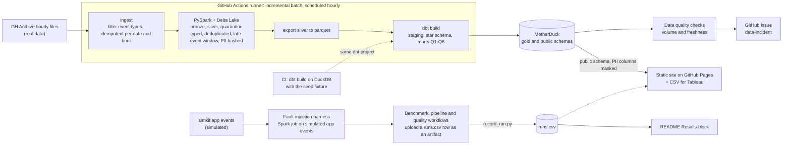

# RepoPulse

RepoPulse is a small data platform that measures the health of open-source projects from public GitHub event data.

**Status:** both phases are built. The first phase is ingest, Spark and Delta Lake, dbt, data quality checks, governance, a static dashboard and the benchmarks. The second adds a comparison of two end-to-end paths, Delta Lake against Apache Iceberg, a Kafka benchmark with fault injection, Trino on Hive-partitioned tables, an Airflow backfill and an SQL agent, all measured on GitHub Actions runners. Measured results are in [Results](#results), taken from `runs.csv`, the run log this repo keeps.

## What it does

- **Input:** hourly public GitHub events from [GH Archive](https://www.gharchive.org/), plus application events generated from an event catalog with schemas.
- **Processing:** a scheduled incremental batch ELT pipeline. PySpark and Delta Lake clean the raw events and hash personal data. dbt builds a star schema with tests and contracts. Volume and freshness checks raise alerts.
- **Output:** metrics such as daily active contributors, cohort retention and the fork → pull request → merge funnel, a public dashboard, and `runs.csv`.

## Architecture



- **Real and simulated data:** GH Archive is real public GitHub activity. The application events come from `simkit` and are **simulated**: there are no real users behind them. The scheduled pipeline processes GH Archive only; the simulated events go through Spark in the fault-injection harness.
- **Layers:** Spark writes bronze (raw lines kept), silver (typed, deduplicated, late events accepted inside a window, PII hashed) and quarantine (events that fail the schema, with a reason). dbt builds staging, the star schema, the six marts for Q1–Q6 and a `public` schema whose identifier columns are masked.
- **Rows for `runs.csv`:** the benchmark, pipeline and quality workflows upload a row as an artifact. `benchmarks/record_run.py` checks its schema and appends it to `runs.csv`.

**The scheduled pipeline runs on a GitHub Actions runner, with gold in MotherDuck.** PySpark and Delta Lake run on the runner and dbt builds the gold layer in MotherDuck: this is path A, and the diagram above draws it. Databricks is measured next to it as path B: the same bronze/silver job runs as a serverless Databricks job and dbt builds on a Databricks SQL warehouse. A first cloud probe was rejected by Databricks, because the token then stored as a secret was of the wrong kind; a second probe, with a personal access token, showed that Databricks can be driven from GitHub Actions, and both paths now have rows in `runs.csv`. Which path becomes the primary one is decided by a rule fixed before measuring, applied to scheduled runs only by `python -m repopulse.pathdecision`. Until scheduled runs of both paths cover enough days the rule keeps path A: that is a lack of data, not a result against Databricks. The rule, the outcome and when to apply it again are in [`docs/probe-result.md`](docs/probe-result.md). The pipeline is an incremental batch that runs every hour, not a stream.

## Results

Every number in this section comes from `runs.csv`: one row per measured run, schema in [`repopulse/runs_log.py`](repopulse/runs_log.py). The tables below are generated by `python -m repopulse.readme_results` and copy the cells of `runs.csv` as written, without rounding and without any computed ratio. Do not edit them by hand. After `benchmarks/record_run.py` adds rows, run the command again; `--check` exits 1 when this block is out of date, and `tests/test_readme_content.py` fails too.

How to read it:

- A row is compared with `variant=baseline` only when it has the same `data_date`, so the same day of data and the same queries Q1–Q6. Only the first table does this.
- The Spark and DuckDB rows use another data date. They are compared with each other, not with `baseline`.
- The engine matrix runs Q1–Q6 on the day of `baseline` on each engine, one row per engine. Its Snowflake row is reused from the dbt build on the seed fixture, so it is not comparable with the others.
- The two-paths table times a whole pipeline, so the paths are compared with each other and not with `baseline`. Its second table counts every run by variant and trigger and gives the nearest-rank p50 and p95 of `total_seconds` over the successful runs; each is the cell of one run. Only runs with `trigger=schedule` enter the primary-path rule.
- The Delta against Iceberg, Kafka, fault-injection, Trino and Airflow tables use the day of `baseline` or a sample of the pipeline, but they time other steps. Each section says what its `total_seconds` covers and what it can be compared with; compare rows inside a table.
- The dbt rows on DuckDB and Snowflake build a small seed fixture, not GH Archive data. The dbt row on a Databricks SQL warehouse builds the silver table of real data.
- The `dq-fault-injection` rows are **simulated** data, and the SQL agent row runs on the hand-made fixture of CI, not on GH Archive. Every other row uses real GH Archive data.
- `run_at`, `git_sha` (first 7 characters) and `data_date` identify the row in `runs.csv`.
- `python -m repopulse.readme_results` exits 2 and writes nothing when `runs.csv` has no row for a variant that one of the second-phase tables needs.

<!-- results:start -->
Generated by `python -m repopulse.readme_results` from `runs.csv`: for each variant and data date the newest run is shown, and every cell is copied from `runs.csv` as written (`—` is an empty cell). Do not edit this block by hand.

### Query layouts vs naive baseline

Real GH Archive data (not simulated). Each row has the same `data_date` as a `baseline` row: the same day of data and the same queries Q1 to Q6. `total_seconds` of `baseline` includes loading the `*.json.gz` files into a table, while the `qopt-*` rows read parquet layouts, so compare `q1_seconds` to `q6_seconds`, not `total_seconds`. `bytes_read` of `baseline` is the size of the input files; for `qopt-*` it is what Q1 to Q6 read. The layouts are described in [`docs/query-optimization.md`](docs/query-optimization.md).

| variant | data_date | total_seconds | q1_seconds | q2_seconds | q3_seconds | q4_seconds | q5_seconds | q6_seconds | peak_rss_mb | bytes_read | row_count | run_at | git_sha |
| --- | --- | --- | --- | --- | --- | --- | --- | --- | --- | --- | --- | --- | --- |
| baseline | 2026-10-25 | 3.611956 | 0.061664 | 0.076715 | 0.039159 | 0.05246 | 0.026339 | 0.052887 | 1210.5 | 295319902 | 1670400 | 2026-11-12T01:24:39+00:00 | 5866025 |
| qopt-clustered | 2026-10-25 | 1.607098 | 0.033002 | 0.361557 | 0.428338 | 0.399178 | 0.023794 | 0.394635 | 975.85 | 416707826 | 1670400 | 2026-11-11T18:53:55+00:00 | e94e9d8 |
| qopt-flat | 2026-10-25 | 1.828283 | 0.133773 | 0.443666 | 0.382593 | 0.391836 | 0.073611 | 0.405215 | 1429.85 | 1491737160 | 1670400 | 2026-11-11T18:53:55+00:00 | e94e9d8 |
| qopt-partitioned | 2026-10-25 | 0.947003 | 0.018212 | 0.250082 | 0.041727 | 0.323164 | 0.016177 | 0.332979 | 1229.95 | 310347620 | 1670400 | 2026-11-11T18:53:55+00:00 | e94e9d8 |
| qopt-partitioned-clustered | 2026-10-25 | 0.941688 | 0.01802 | 0.238865 | 0.040602 | 0.315754 | 0.018154 | 0.322356 | 1220.75 | 290407457 | 1670400 | 2026-11-11T18:53:55+00:00 | e94e9d8 |

### Engine matrix: Q1 to Q6 on six engines (real GH Archive data)

Real GH Archive data (not simulated): the same reference day as `baseline` and the same queries Q1 to Q6 on every engine, one row per engine in a fixed order (the newest `matrix-<engine>` run). Each engine loads the day first (not timed), runs Q1 to Q6 once as a warm-up, then several timed runs; `q1_seconds` to `q6_seconds` are medians and `total_seconds` is the median of the per-run sum of Q1 to Q6, so unlike `baseline` it does not include loading. `timing` says where the clock runs: `in-process` engines (`duckdb`, `spark`) are timed in the process that runs the query, `client` engines (`motherduck`, `databricks-sql`) are timed by the client on the runner, so their times include the network, and `notebook` (`databricks-serverless`) is timed inside the Databricks notebook. A row is written only when its results matched DuckDB on the same data (`cross_check`). The `snowflake` row is reused from `dbt-build-snowflake` (the trial is not spent again): the build time of the marts with `dbt build` on the seed fixture, a different measurement that is not comparable with the other rows. Method: [`docs/engine-matrix.md`](docs/engine-matrix.md).

| engine | source | variant | data_date | total_seconds | q1_seconds | q2_seconds | q3_seconds | q4_seconds | q5_seconds | q6_seconds | row_count | timing | cross_check | run_at | git_sha |
| --- | --- | --- | --- | --- | --- | --- | --- | --- | --- | --- | --- | --- | --- | --- | --- |
| duckdb | measured: Q1-Q6 on the reference day | matrix-duckdb | 2026-10-25 | 1.379693 | 0.070564 | 0.088508 | 0.977428 | 0.162533 | 0.030462 | 0.057046 | 1670400 | in-process | content | 2026-11-12T07:32:38+00:00 | c82658b |
| spark | measured: Q1-Q6 on the reference day | matrix-spark | 2026-10-25 | 19.264915 | 2.311471 | 1.365517 | 5.332565 | 6.270693 | 0.910143 | 3.14992 | 1670400 | in-process | content | 2026-11-12T07:32:54+00:00 | c82658b |
| databricks-serverless | measured: Q1-Q6 on the reference day | matrix-databricks-serverless | 2026-10-25 | 11.951003 | 1.938565 | 1.346388 | 2.213751 | 2.439241 | 1.367668 | 2.561126 | 1670400 | notebook | content | 2026-11-12T07:37:35+00:00 | c82658b |
| databricks-sql | measured: Q1-Q6 on the reference day | matrix-databricks-sql | 2026-10-25 | 10.036121 | 1.639145 | 1.202641 | 1.883172 | 2.073748 | 1.131386 | 1.878064 | 1670400 | client | content | 2026-11-12T07:35:56+00:00 | c82658b |
| motherduck | measured: Q1-Q6 on the reference day | matrix-motherduck | 2026-10-25 | 1.945281 | 0.084298 | 0.106439 | 1.26195 | 0.308665 | 0.04579 | 0.078294 | 1670400 | client | content | 2026-11-12T07:35:32+00:00 | c82658b |
| snowflake | reused dbt-build-snowflake: dbt build of the marts on the seed fixture, not comparable | dbt-build-snowflake | 2026-01-05 | 22.600090742111206 | 1.398242473602295 | 1.2782909870147705 | 2.0330214500427246 | 1.7248523235321045 | 1.2184998989105225 | 1.9702086448669434 | 36 | — | — | 2026-11-11T16:20:35+00:00 | ee38cf0 |

### Spark vs DuckDB at 1, 7 and 30 days

Real GH Archive data (not simulated), read from the same files by both engines. These rows have a different data date than `baseline` and a different measured step, so they are not compared with `baseline`: compare a `spark-Nd` row with the `duckdb-Nd` row of the same N. `notes` is copied from `runs.csv`; Spark startup is outside `total_seconds`. Method: [`docs/benchmark-scale.md`](docs/benchmark-scale.md).

| variant | data_date | total_seconds | q1_seconds | q2_seconds | q3_seconds | q4_seconds | q5_seconds | q6_seconds | peak_rss_mb | bytes_read | row_count | run_at | git_sha | notes |
| --- | --- | --- | --- | --- | --- | --- | --- | --- | --- | --- | --- | --- | --- | --- |
| duckdb-1d | 2025-06-01 | 0.585144 | 0.031557 | 0.030172 | 0.025078 | 0.038156 | 0.023828 | 0.031522 | 340.8 | 18031701 | 485301 | 2026-11-11T14:14:02+00:00 | 8ae25be | engine=duckdb days=1 runs=3 median |
| spark-1d | 2025-06-01 | 30.059834 | 5.476553 | 2.760499 | 5.720355 | 5.587724 | 1.160616 | 3.947883 | 8220.7 | 18031701 | 485301 | 2026-11-11T14:14:02+00:00 | 8ae25be | engine=spark days=1 runs=3 median startup_seconds=5.506 |
| duckdb-7d | 2025-06-01 | 4.328583 | 0.242044 | 0.235877 | 0.118228 | 0.272763 | 0.155436 | 0.187602 | 1035.9 | 177760032 | 4481964 | 2026-11-11T14:14:02+00:00 | 8ae25be | engine=duckdb days=7 runs=3 median |
| spark-7d | 2025-06-01 | 96.747028 | 11.215797 | 6.621274 | 16.596512 | 23.330557 | 2.50443 | 13.586268 | 10707.3 | 177760032 | 4481964 | 2026-11-11T14:14:02+00:00 | 8ae25be | engine=spark days=7 runs=3 median startup_seconds=5.464 |
| duckdb-30d | 2025-06-01 | 18.531286 | 0.989984 | 0.989991 | 0.463355 | 1.135635 | 0.639533 | 0.730878 | 3597.1 | 760712353 | 19404072 | 2026-11-11T14:14:02+00:00 | 8ae25be | engine=duckdb days=30 runs=3 median missing_hours=2 |
| spark-30d | 2025-06-01 | 320.603835 | 26.315635 | 17.380997 | 57.96735 | 88.185643 | 7.118395 | 43.593821 | 9349.7 | 760712353 | 19404072 | 2026-11-11T14:14:02+00:00 | 8ae25be | engine=spark days=30 runs=3 median startup_seconds=5.441 missing_hours=2 |

### dbt build: DuckDB vs Snowflake

Both builds run the same dbt project on the seed fixture (a small set of hand-made events for CI), not on GH Archive data, and are not compared with `baseline`. `total_seconds` is the whole `dbt build`; `q1_seconds` to `q6_seconds` are the build time of the mart for Q1 to Q6, not the time of the query; `row_count` is the number of seed rows; `lines_changed` is read from `notes`. Method: [`docs/snowflake-port.md`](docs/snowflake-port.md).

| variant | data_date | total_seconds | q1_seconds | q2_seconds | q3_seconds | q4_seconds | q5_seconds | q6_seconds | peak_rss_mb | bytes_read | row_count | lines_changed | run_at | git_sha |
| --- | --- | --- | --- | --- | --- | --- | --- | --- | --- | --- | --- | --- | --- | --- |
| dbt-build-duckdb | 2026-01-05 | 2.217414379119873 | 0.06964230537414551 | 0.16405320167541504 | 0.07715225219726562 | 0.06273102760314941 | 0.060391902923583984 | 0.07206177711486816 | — | — | 36 | 190 | 2026-11-11T16:20:05+00:00 | ee38cf0 |
| dbt-build-snowflake | 2026-01-05 | 22.600090742111206 | 1.398242473602295 | 1.2782909870147705 | 2.0330214500427246 | 1.7248523235321045 | 1.2184998989105225 | 1.9702086448669434 | — | — | 36 | 190 | 2026-11-11T16:20:35+00:00 | ee38cf0 |

### Data quality fault injection (simulated data)

Simulated data: app events from `simkit` (no real users) with a known number of faults injected, run through the Spark job. `injected` and `caught` count faults; `false_alarms` counts findings that match no injected fault, including those of the clean runs (`clean_runs`). The six fault types show caught/injected. Every value after `row_count` is read from `notes`. Method: [`docs/data-quality.md`](docs/data-quality.md).

| variant | data_date | total_seconds | row_count | simulated | seed | users | days | injected | caught | false_alarms | clean_runs | duplicate | null | wrong_type | late | schema_drift | bot | run_at | git_sha |
| --- | --- | --- | --- | --- | --- | --- | --- | --- | --- | --- | --- | --- | --- | --- | --- | --- | --- | --- | --- |
| dq-fault-injection | 2026-11-01 | 81.907 | 677 | true | 42 | 60 | 2 | 27 | 27 | 0 | 3 | 5/5 | 5/5 | 5/5 | 5/5 | 5/5 | 2/2 | 2026-11-11T18:22:59+00:00 | 0bc1ad4 |

### dbt build on a Databricks SQL warehouse (real GH Archive data)

Real GH Archive data (not simulated): the dbt project builds on a Databricks SQL warehouse from the silver Delta table written by the Databricks bronze/silver job, not from the hand-made CI events, so these rows are compared neither with the builds above nor with `baseline`. `total_seconds` is the whole `dbt build`; `q1_seconds` to `q6_seconds` are the build time of the mart for Q1 to Q6; `row_count` is the number of staged events and `data_date` the earliest `event_date`; `max_event_date` and `lines_changed` are read from `notes`. Method: [`docs/dbt-databricks.md`](docs/dbt-databricks.md).

| variant | data_date | total_seconds | q1_seconds | q2_seconds | q3_seconds | q4_seconds | q5_seconds | q6_seconds | peak_rss_mb | bytes_read | row_count | max_event_date | lines_changed | run_at | git_sha |
| --- | --- | --- | --- | --- | --- | --- | --- | --- | --- | --- | --- | --- | --- | --- | --- |
| dbt-build-databricks | 2026-10-25 | 121.6275634765625 | 10.2672700881958 | 7.4214441776275635 | 9.794240236282349 | 9.563957691192627 | 7.928206205368042 | 7.523385286331177 | — | — | 206827 | 2026-10-25 | 501 | 2026-11-12T06:15:38+00:00 | 4553df1 |

### Two paths, end to end: runner + MotherDuck vs Databricks (real GH Archive data)

Real GH Archive data (not simulated): the same incremental batch (ingest, bronze/silver, gold, then Q1 to Q6) on the same window of data, run by a GitHub Actions workflow. `path-a-runner` runs PySpark and Delta Lake on the runner and builds gold in MotherDuck; `path-b-databricks` runs bronze/silver as a serverless Databricks job and builds gold with dbt on a Databricks SQL warehouse. These rows are not compared with `baseline`: they time a whole pipeline, not Q1 to Q6 alone. `total_seconds` is the sum of the timed steps (`ingest_seconds` and the other step times in `notes`), without runner setup and queueing, which have their own columns; `q1_seconds` to `q6_seconds` are the time to read the mart of each question from the gold; `row_count` is the number of rows the bronze/silver step inserted into silver (none when the silver table already held the hours of the window, while `bronze_rows` in `notes` is the number of rows the step read); `status`, `trigger` and the step times are read from `notes`. The first table is the newest run of each path. The second counts every run by variant and `trigger`, failed runs included; `e2e_p50_seconds` and `e2e_p95_seconds` are nearest-rank percentiles of `total_seconds` over the successful runs of the group, so each is the `total_seconds` of one run, copied from `runs.csv`. Only runs with `trigger=schedule` enter the primary-path rule; a `push` run only tests the workflow. The rule and where it stands are in [`docs/probe-result.md`](docs/probe-result.md), the method in [`docs/path-comparison.md`](docs/path-comparison.md).

| variant | data_date | total_seconds | q1_seconds | q2_seconds | q3_seconds | q4_seconds | q5_seconds | q6_seconds | row_count | status | trigger | ingest_seconds | spark_seconds | export_seconds | databricks_seconds | warehouse_seconds | dbt_seconds | queries_seconds | queue_seconds | setup_seconds | job_queue_seconds | job_setup_seconds | warehouse_start_seconds | bronze_rows | run_id | run_at | git_sha |
| --- | --- | --- | --- | --- | --- | --- | --- | --- | --- | --- | --- | --- | --- | --- | --- | --- | --- | --- | --- | --- | --- | --- | --- | --- | --- | --- | --- |
| path-a-runner | 2026-10-25 | 56.49300000000001 | 0.25826 | 0.059017 | 0.059248 | 0.05919 | 0.059446 | 0.059322 | 68488 | success | push | 1.635 | 24.605 | 11.017 | — | — | 17.795 | 1.441 | 2.0 | 22.149878 | — | — | — | 68488 | 43175427031 | 2026-11-12T07:27:53+00:00 | 52c9d56 |
| path-b-databricks | 2026-10-25 | 162.142 | 0.822 | 0.758 | 0.833 | 0.76 | 0.724 | 0.778 | 0 | success | push | 2.095 | — | — | 50.846 | 0.206 | 104.253 | 4.742 | 2.0 | 28.303435 | — | 3.0 | 0.0 | 68488 | 43175427031 | 2026-11-12T07:27:52+00:00 | 52c9d56 |

Every run, counted by variant and trigger:

| variant | trigger | runs | successes | e2e_p50_seconds | e2e_p95_seconds |
| --- | --- | --- | --- | --- | --- |
| path-a-runner | push | 2 | 2 | 55.344 | 56.49300000000001 |
| path-b-databricks | push | 2 | 2 | 162.142 | 217.882 |

### Delta Lake vs Apache Iceberg (real GH Archive data)

Real GH Archive data (not simulated): the reference day of `baseline`, written once as a Delta table and once as an Iceberg table with PySpark (local mode) on a GitHub Actions runner. Both tables are unpartitioned and use the default settings of their format. Each run writes the table, runs Q1 to Q6, merges the last two hours of the day into it (`MERGE INTO`, then the same statement again to check it is idempotent) and reads the version from before the merge (time travel). `total_seconds` is the write, Q1 to Q6, both merges and the time travel; it leaves out starting Spark and loading the JSON (`load_seconds` in `notes`), so it is not comparable with `baseline` or `spark-Nd`: compare `format-delta` with `format-iceberg` only. `table_bytes` and `table_files` are the data files after the write, before the merge. `row_count` is the rows of the table after the merges; `cross_check=full` means the other format gave the same row counts. Method and limits: [`docs/iceberg-vs-delta.md`](docs/iceberg-vs-delta.md).

| variant | data_date | total_seconds | q1_seconds | q2_seconds | q3_seconds | q4_seconds | q5_seconds | q6_seconds | peak_rss_mb | row_count | write_seconds | merge_seconds | merge_rerun_seconds | time_travel_seconds | load_seconds | table_bytes | table_files | cross_check | run_at | git_sha |
| --- | --- | --- | --- | --- | --- | --- | --- | --- | --- | --- | --- | --- | --- | --- | --- | --- | --- | --- | --- | --- |
| format-delta | 2026-10-25 | 71.87834 | 7.64757 | 4.878722 | 13.089235 | 12.407299 | 2.199803 | 7.016043 | 9039.9 | 1670400 | 8.116 | 8.259 | 6.927 | 1.105 | 15.958 | 352367811 | 5 | full | 2026-11-12T02:13:36+00:00 | 39d76aa |
| format-iceberg | 2026-10-25 | 56.041629 | 7.251662 | 3.726932 | 10.22701 | 9.219515 | 1.486354 | 5.14486 | 8368.2 | 1670400 | 5.841 | 6.147 | 6.823 | 0.068 | 16.217 | 214203312 | 5 | full | 2026-11-12T02:13:36+00:00 | 39d76aa |

### Kafka to Spark Structured Streaming to Delta: throughput (real GH Archive data)

Real GH Archive data (not simulated): the reference day is produced into an Apache Kafka cluster (KRaft mode, replicated topic) that runs in Docker Compose on a GitHub Actions runner, read back with Spark Structured Streaming into a bronze Delta table, and reconciled with the line count of the source files. A row is written only when every count matches (`match=true`); `row_count` is the rows in Delta and `bytes_read` the bytes of the produced values. `total_seconds` is `produce_seconds` plus `consume_seconds`; creating the topic, starting Spark and the reconciliation are not timed. The trigger is `availableNow`: production finishes before consumption starts, so `consume_events_per_s` is the rate at which Spark drains an existing backlog into Delta, not the latency of a stream that runs continuously, and `produce_events_per_s` is one Python producer writing to brokers that share the runner's CPU and disk. Each partition count is measured once, with no warm-up, in one Spark session, so the first one also pays one-time initialisation. These rows move the day through Kafka instead of running Q1 to Q6, so they are not compared with `baseline`. The scheduled pipeline is an incremental batch, not this benchmark. Method: [`docs/streaming.md`](docs/streaming.md).

| variant | data_date | total_seconds | bytes_read | row_count | partitions | brokers | rf | min_isr | produce_seconds | consume_seconds | produce_events_per_s | consume_events_per_s | batch_rows | match | trigger | micro_batches | max_offsets_per_trigger | kafka | run_at | git_sha |
| --- | --- | --- | --- | --- | --- | --- | --- | --- | --- | --- | --- | --- | --- | --- | --- | --- | --- | --- | --- | --- |
| streaming-throughput-p1 | 2026-10-25 | 72.101 | 1371864797 | 1670400 | 1 | 3 | 3 | 2 | 24.132 | 47.969 | 69219.3 | 34822.5 | 1670400 | true | availableNow | 9 | 200000 | apache/kafka:4.0.0 | 2026-11-12T01:18:30+00:00 | d5df6de |
| streaming-throughput-p3 | 2026-10-25 | 49.884 | 1371864797 | 1670400 | 3 | 3 | 3 | 2 | 25.261 | 24.623 | 66125.6 | 67839.0 | 1670400 | true | availableNow | 9 | 200000 | apache/kafka:4.0.0 | 2026-11-12T01:18:30+00:00 | d5df6de |
| streaming-throughput-p6 | 2026-10-25 | 50.067 | 1371864797 | 1670400 | 6 | 3 | 3 | 2 | 26.947 | 23.12 | 61988.3 | 72249.1 | 1670400 | true | availableNow | 9 | 200000 | apache/kafka:4.0.0 | 2026-11-12T01:18:30+00:00 | d5df6de |

### Streaming fault tolerance: broker kill and consumer kill (real GH Archive data)

Real GH Archive data (not simulated): the Kafka and Spark path above with one fault injected in the middle of a run. In `broker-kill` a broker is killed (SIGKILL on its container) while the producer is writing, and the topic is then drained into Delta with the remaining brokers; in `consumer-kill` the Spark consumer process, JVM included, is killed after a few micro-batches have been committed and restarted on the same checkpoint and Delta table. After each case the source and the sink are compared by content (a multiset of the SHA-256 of every line), not only by count: `lost` is source lines with no message in Delta, `duplicates` is `offset_duplicates` (the same Kafka message written twice) plus `content_duplicates` (the same content at another offset). They are measured, not assumed, and a case whose fault did not land in the middle of the run writes no row. `failover_seconds` and `resync_seconds` (broker) and `restart_first_commit_seconds` and `restart_drain_seconds` (consumer) are read by polling, so they are upper bounds. `total_seconds` adds up the produce and consume times (or the produce time and the two consumer runs) of the case, so these rows are not comparable with each other or with the throughput table. There is one run per case, not a median, and the brokers share one runner, so a kill here is a process crash, not a machine or network failure. Method: [`docs/streaming-fault.md`](docs/streaming-fault.md).

| variant | data_date | total_seconds | row_count | lost | duplicates | offset_duplicates | content_duplicates | unexpected | source_rows | delta_rows | failover_seconds | resync_seconds | max_delivery_gap_after_kill_seconds | restart_first_commit_seconds | restart_drain_seconds | micro_batches_before_kill | micro_batches_after_kill | uncommitted_batches_at_kill | partitions | hours | run_at | git_sha |
| --- | --- | --- | --- | --- | --- | --- | --- | --- | --- | --- | --- | --- | --- | --- | --- | --- | --- | --- | --- | --- | --- | --- |
| streaming-fault-broker-kill | 2026-10-25 | 105.89 | 1670400 | 0 | 0 | 0 | 0 | 0 | 1670400 | 1670400 | 6.071 | 4.904 | 8.359 | — | — | 0 | 34 | — | 3 | 24 | 2026-11-12T02:40:47+00:00 | 19eaaa2 |
| streaming-fault-consumer-kill | 2026-10-25 | 138.041 | 1670400 | 0 | 0 | 0 | 0 | 0 | 1670400 | 1670400 | — | — | — | 18.46 | 81.363 | 5 | 29 | 1 | 3 | 24 | 2026-11-12T02:40:47+00:00 | 19eaaa2 |

### Trino on Hive-partitioned parquet (real GH Archive data)

Real GH Archive data (not simulated): the reference day in the four parquet layouts of the `qopt-*` rows (flat, partitioned by event type, clustered by sort order, and both), written to MinIO, registered as external tables in a Hive Metastore and queried with Q1 to Q6 on one Trino node. Everything runs in Docker Compose on a GitHub Actions runner. `qN_seconds` is the client-side wall time of query N and `total_seconds` the sum of Q1 to Q6 without any loading, as the median of several timed runs after one untimed warm-up per layout. `bytes_read` is what Trino read from storage (`physicalInputBytes`) summed over Q1 to Q6 in the first timed run; the bytes and rows of each query are in `notes`. Every result was checked against DuckDB (`cross_check`). The server stays up and the data goes over HTTP, while `baseline` loads the files in its own process, so these rows are not comparable with `baseline` or `qopt-*`: compare the `trino-*` rows with each other, `trino-flat` being the layout before. Method: [`docs/trino-hive.md`](docs/trino-hive.md).

| variant | data_date | total_seconds | q1_seconds | q2_seconds | q3_seconds | q4_seconds | q5_seconds | q6_seconds | bytes_read | row_count | partition_by | sort_by | files | layout_bytes | trino | bytes_equal_across_runs | cross_check | run_at | git_sha |
| --- | --- | --- | --- | --- | --- | --- | --- | --- | --- | --- | --- | --- | --- | --- | --- | --- | --- | --- | --- |
| trino-flat | 2026-10-25 | 11.065254 | 1.064501 | 1.071864 | 2.365977 | 4.24397 | 0.363652 | 1.994511 | 5272074760 | 1670400 | none | none | 1 | 370155952 | 484 | true | full | 2026-11-12T01:26:14+00:00 | 5866025 |
| trino-partitioned | 2026-10-25 | 4.031387 | 0.378627 | 0.248051 | 0.456132 | 1.685715 | 0.171349 | 1.086085 | 439061897 | 1670400 | type | none | 16 | 350231636 | 484 | true | full | 2026-11-12T01:26:14+00:00 | 5866025 |
| trino-clustered | 2026-10-25 | 4.732549 | 0.292307 | 0.402464 | 0.840337 | 1.958731 | 0.138126 | 1.031803 | 1283007819 | 1670400 | none | type+repo.name+created_at | 1 | 302287930 | 484 | true | full | 2026-11-12T01:26:14+00:00 | 5866025 |
| trino-partitioned-clustered | 2026-10-25 | 3.844165 | 0.309468 | 0.214639 | 0.380599 | 1.704482 | 0.150717 | 1.005081 | 408029209 | 1670400 | type | repo.name+created_at | 16 | 302247116 | 484 | true | full | 2026-11-12T01:26:14+00:00 | 5866025 |

### Airflow backfill (real GH Archive data)

Real GH Archive data (not simulated): the Airflow DAG `dags/repopulse_pipeline.py` runs the chain of the scheduled pipeline (ingest, Spark bronze/silver, export, dbt build), an incremental batch, as a backfill of N daily runs with `airflow standalone` on a GitHub Actions runner. dbt builds on a local DuckDB file (`target=ci`), not on MotherDuck. Each daily run processes only `hours_per_day` hours of its day, ending at `last_hour`: a sample of the day, not the whole day. `total_seconds` is the wall-clock time from creating the backfill to the end of the last run, Airflow's scheduling delay included; `row_count` is the sum of the silver rows inserted over the days; `sla_missed` is counted from the duration of each run against `sla_minutes`, not from the Airflow callback. A row is written only when the backfill succeeded. These rows are not compared with `baseline` or with the two paths. The cron of the scheduled pipeline is unchanged: the two ways of orchestrating are measured side by side. Method: [`docs/airflow.md`](docs/airflow.md).

| variant | data_date | total_seconds | row_count | engine | days | hours_per_day | last_hour | runs_success | runs_failed | sla_minutes | sla_missed | max_active_runs | target | trigger | run_at | git_sha |
| --- | --- | --- | --- | --- | --- | --- | --- | --- | --- | --- | --- | --- | --- | --- | --- | --- |
| airflow-backfill-2d | 2026-10-25 | 88.716 | 105070 | airflow-3.4.0 | 2 | 1 | 15 | 2 | 0 | 30 | 0 | 1 | ci | pull_request | 2026-11-12T02:32:40+00:00 | d1cc3f5 |

### SQL agent on a local model (CI fixture data, not GH Archive)

This is not GH Archive data: the questions run on the fixture that CI builds with dbt (hand-made events, no real users), so `data_date` is the latest event date of that fixture and `dataset=ci-fixture`. A language model running locally on the repo owner's machine (model and hardware in `notes`) answers each question of `repopulse/sql_agent_eval.toml` by writing DuckDB SQL against the read-only `public` schema. `accuracy` is execution accuracy, correct answers over questions: an answer is correct when its result equals the result of the reference SQL on the same database. `row_count` is the number of questions, `total_seconds` the sum of the time per question and `p50_question_s` the median time per question, as written by the evaluation. CI never calls a real model, so this row is a one-off measurement of one model on a small set of questions, not a CI result and not a comparison with other models or with `baseline`. The `hw` value in `notes` has spaces in it, so it is only shown in the `notes` column. Method: [`docs/sql-agent.md`](docs/sql-agent.md).

| variant | data_date | total_seconds | row_count | accuracy | p50_question_s | model | dataset | run_at | git_sha | notes |
| --- | --- | --- | --- | --- | --- | --- | --- | --- | --- | --- |
| sql-agent-qwen3-6-35b-a3b | 2026-04-07 | 354.638 | 16 | 14/16 | 19.037 | Qwen3.6-35B-A3B | ci-fixture | 2026-11-12T07:36:34+00:00 | 13adca6 | accuracy=14/16; p50_question_s=19.037; model=Qwen3.6-35B-A3B; hw=RTX4060-laptop-8GB llama.cpp -ngl99 --cpu-moe; dataset=ci-fixture |

### Other runs

Not compared with `baseline`: either there is no baseline row with the same `data_date`, or the variant is not one of the groups above. `notes` is copied from `runs.csv`.

| variant | data_date | total_seconds | q1_seconds | q2_seconds | q3_seconds | q4_seconds | q5_seconds | q6_seconds | peak_rss_mb | bytes_read | row_count | run_at | git_sha | notes |
| --- | --- | --- | --- | --- | --- | --- | --- | --- | --- | --- | --- | --- | --- | --- |
| databricks-bronze-silver | 2026-10-25 | 107.948 | — | — | — | — | — | — | — | — | 206827 | 2026-11-12T01:32:05+00:00 | b965514 | source=gharchive last_hour=2026-10-25T23 hours=3 bronze_rows=206827 quarantined_total=0 duplicates_dropped=0 upload_s=3.79 setup_s=3.0 execution_s=88.0 cleanup_s=1.0 run_s=92.42 run_id=43134787015 trigger=push rerun_silver_inserted=0 |

The full log, with every run and not only the newest, is [`runs.csv`](runs.csv).
<!-- results:end -->

### Not measured yet

Nothing in this list has a row in `runs.csv`, so this README gives no number for it:

- Event counts and sizes at bronze, silver and gold, the time to add one day of data compared with a full refresh, and the share of events rejected for schema or duplicates (measures M1, M2 and M9 of [`docs/plan.md`](docs/plan.md)).
- Data freshness at p50 and p95 (M3). It needs many scheduled runs to accumulate.
- Which path wins under the primary-path rule. The rule needs scheduled runs of both paths on several UTC days, and the generated table in [`docs/probe-result.md`](docs/probe-result.md) shows where the count stands.
- The daily quota of Databricks Free Edition and the capacity of its Volumes. The probe checks that they can be used, not how large they are.
- The Tableau Public workbook. The dashboard build writes the CSV files; publishing is a manual step by the repo owner.

The scheduled pipeline uploads its `pipeline-incremental` rows as workflow artifacts. They reach `runs.csv` only when someone merges them with `record_run.py`; a merged row then appears above under "Other runs". The rows of the two paths are merged the same way and appear in the two-paths table.

## Design decisions

- **Path A on the schedule, Databricks measured as path B.** The first probe reached MotherDuck from GitHub Actions but was rejected by Databricks, so Spark and Delta run on the runner and gold goes to MotherDuck. Once a second probe showed that Databricks can be driven from Actions, the choice became a measurement: both paths run the same incremental batch on the same window of data, and a rule fixed before measuring picks the primary one from the scheduled runs. Until there are enough of them the rule keeps path A. See [`docs/probe-result.md`](docs/probe-result.md) and [`docs/path-comparison.md`](docs/path-comparison.md).
- **DuckDB in CI, MotherDuck for gold.** CI builds the dbt project on DuckDB with a seed fixture, so it needs no secret and no network data. The scheduled run builds the same project on MotherDuck. MotherDuck rejects DuckDB clients newer than it supports, so the workflows pin the DuckDB version. See [`docs/dbt-models.md`](docs/dbt-models.md) and [`docs/pipeline.md`](docs/pipeline.md).
- **Spark and Delta Lake for bronze and silver.** Delta gives the merge that makes silver inserts safe to repeat. Spark runs in local mode on the runner and each run handles a few hours of data, because the runner has 14 GB of disk. See [`docs/spark-jobs.md`](docs/spark-jobs.md).
- **Idempotent per (date, hour).** Ingest skips hours it has already landed, bronze and quarantine overwrite exactly their hour, silver inserts only new event ids, and staging skips ids it has seen. Running the same hour twice does not change row counts.
- **PII is hashed before silver, and the public schema masks identifiers.** Commit author emails and names are salted SHA-256 hashes from silver on. The `public` schema masks user keys and logins, and dbt tests plus a scan flag a raw email in gold or public. GitHub logins are public, so masking them is pseudonymisation, not anonymisation. See [`docs/governance.md`](docs/governance.md).
- **Quarantine instead of silent drops.** An event that fails the schema, arrives outside the late window or cannot be parsed goes to a quarantine table with a reason. The Spark summary reconciles bronze rows with silver inserts, dropped duplicates and quarantine.
- **A fixed set of questions, Q1–Q6.** The same SQL files define the dbt marts and are the queries every benchmark runs, and a test checks that the marts return the same results. Optimisations are therefore measured on the work the product does.
- **`runs.csv` is the only source of numbers.** Rows are schema-checked before they are written, and this README's results are generated from the file and checked by a test.
- **A static dashboard on GitHub Pages.** Databricks dashboards cannot be shared publicly, and the gold layer of the scheduled pipeline is in MotherDuck. The site reads only the `public` schema, and the same data is exported as CSV for Tableau. See [`docs/dashboard.md`](docs/dashboard.md).
- **Application events are simulated.** There is no app with real users, so `simkit` generates events from the catalog with a fixed seed and injects faults that are known in advance. That is what makes fault detection measurable. Wherever these events are reported they are labelled simulated. See [`docs/simkit.md`](docs/simkit.md).
- **One dbt project for two engines.** The SQL avoids DuckDB-only syntax outside a small macro file, and a test enforces it, so the same project also builds on Snowflake. See [`docs/snowflake-port.md`](docs/snowflake-port.md).

## Plan

The work runs in two phases:

1. **Cloud phase (built):** everything runs on free cloud services and GitHub Actions. No local Docker is needed.
2. **Second phase (built):** adds what free cloud tiers cannot offer: a Kafka benchmark with fault-injection tests, Trino on Hive-partitioned tables, and an Airflow backfill. It ran on GitHub Actions runners, with Docker Compose inside the workflows, not on the owner's machine. Alongside it, the repo compares the two paths, Delta Lake with Iceberg and six engines, and has a semantic layer and an SQL agent.

Details are in [`docs/plan.md`](docs/plan.md) (Vietnamese). Progress is tracked in [`docs/progress.md`](docs/progress.md).

## Documentation

Most pages are in Vietnamese; the benchmark pages are in English.

| Page | Topic |
|---|---|
| [`docs/probe-result.md`](docs/probe-result.md) | The cloud probe, the rule that picks the primary path, and where it stands |
| [`docs/eventspec.md`](docs/eventspec.md), [`docs/simkit.md`](docs/simkit.md) | Event catalog and schemas; the simulated event generator with known faults |
| [`docs/spark-jobs.md`](docs/spark-jobs.md) | Bronze, silver and quarantine tables, rules, PII hashing |
| [`docs/dbt-models.md`](docs/dbt-models.md) | Staging, star schema, marts Q1–Q6, incremental models |
| [`docs/pipeline.md`](docs/pipeline.md) | The scheduled incremental batch workflow |
| [`docs/data-quality.md`](docs/data-quality.md) | Fault injection, volume and freshness checks, Issue alerts |
| [`docs/governance.md`](docs/governance.md) | PII labels, roles, the masked `public` schema |
| [`docs/dashboard.md`](docs/dashboard.md) | The static site and the Tableau CSV export |
| [`docs/query-optimization.md`](docs/query-optimization.md) | Partitioned and clustered layouts against the baseline |
| [`docs/benchmark-scale.md`](docs/benchmark-scale.md) | Spark against DuckDB at 1, 7 and 30 days |
| [`docs/iceberg-vs-delta.md`](docs/iceberg-vs-delta.md) | Delta Lake against Apache Iceberg: write, Q1–Q6, MERGE, time travel |
| [`docs/engine-matrix.md`](docs/engine-matrix.md) | Q1–Q6 on the reference day on six engines, one README table |
| [`docs/snowflake-port.md`](docs/snowflake-port.md) | Running the dbt project on Snowflake |
| [`docs/databricks-job.md`](docs/databricks-job.md) | The same bronze/silver incremental batch as a serverless Databricks job (path B) |
| [`docs/dbt-databricks.md`](docs/dbt-databricks.md) | The dbt project built on a Databricks SQL warehouse (path B) |
| [`docs/path-comparison.md`](docs/path-comparison.md) | The two end-to-end paths run on the same data window, and how they are compared |
| [`docs/streaming.md`](docs/streaming.md), [`docs/streaming-fault.md`](docs/streaming-fault.md) | The Kafka benchmark (produce, read into Delta, reconcile) and the tests that kill a broker or the consumer |
| [`docs/trino-hive.md`](docs/trino-hive.md) | Q1–Q6 on Trino over Hive-partitioned parquet |
| [`docs/airflow.md`](docs/airflow.md) | The Airflow DAG and its backfill on a runner |
| [`docs/semantic-layer.md`](docs/semantic-layer.md) | MetricFlow metrics on the public marts |
| [`docs/sql-agent.md`](docs/sql-agent.md) | The read-only SQL agent over the public schema, and its evaluation |

## Baseline benchmark

Every optimisation is measured against one naive baseline, on the same day of data and the same six questions (Q1–Q6).

- **Reference day:** one full day of real GH Archive data. The date, the selection criteria and the sha256 and size of each of the 24 hourly files are in [`benchmarks/reference.toml`](benchmarks/reference.toml), generated by `benchmarks/select_reference_day.py`. A day qualifies when all 24 hours exist, every hour has PushEvents (some recent GH Archive hours lost whole event types), and no hour's size is more than `max_size_ratio` away from the median hour.
- **Naive pipeline:** [`benchmarks/naive_duckdb.py`](benchmarks/naive_duckdb.py) reads every `*.json.gz` straight into one DuckDB table (full refresh, no partitioning, no deduplication), then runs [`benchmarks/queries/q1.sql`](benchmarks/queries) … `q6.sql`. Repos are scoped by the seed [`transform/seeds/repos_data_ecosystem.csv`](transform/seeds/repos_data_ecosystem.csv). The queries use pull requests, issues, reviews, comments and forks only, never PushEvent/CreateEvent/DeleteEvent. Each SQL file starts with the definitions it uses (bot, contribution, first response…).
- **Measurements:** total time, time per query, peak RSS, bytes read and raw row count; median of the runs on a GitHub-hosted `ubuntu-latest` runner via [`.github/workflows/benchmark.yml`](.github/workflows/benchmark.yml). The workflow uploads one `runs.csv` row as the `benchmark-row` artifact; `python benchmarks/record_run.py benchmark-row.csv` appends it to `runs.csv` after a schema check. The results are in [Results](#results).

Run it locally:

```bash
pip install -e ".[dev]"
python benchmarks/fetch_reference.py        # download + verify checksums; non-zero exit on mismatch
python benchmarks/naive_duckdb.py --runs 5 --variant baseline --git-sha "$(git rev-parse --short HEAD)" --out out/benchmark-row.csv
```

### Q6 health score

For each seed repo with at least one contribution in the data, six components in [0, 1]:

| Component | Definition | From |
|---|---|---|
| activity | human contributors / the maximum over scored repos | Q1 |
| retention | share of human contributors active in at least two distinct ISO weeks (a Q6-only measure from the same activity data as Q1; not the Q2 W+4/W+12 cohort retention) | Q1 activity |
| merge | PRs merged / human PRs opened | Q3 |
| response | issues + PRs with a first human response from someone other than the author / opened | Q4 |
| close | issues + PRs closed / opened | Q4 |
| diversity | 1 − share of human contributions made by the top contributor | Q5 |

`health_score = 100 × (0.25·activity + 0.15·retention + 0.15·merge + 0.20·response + 0.10·close + 0.15·diversity)`, rounded to two decimals; ties are broken by repo name. Bots (logins ending in `[bot]` or `-bot`) are excluded from every component; their share is reported separately in Q5.

## Data sources and licences

- GH Archive data is real public GitHub activity, not simulated. GH Archive publishes no explicit licence for its event data. This repo downloads it at run time and does not redistribute raw files.
- Application events in the cloud phase are simulated and are labelled as simulated wherever they are reported.

## Licence

MIT. See [`LICENSE`](LICENSE).
