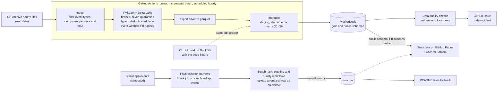

# RepoPulse

RepoPulse is a small data platform that measures the health of open-source projects from public GitHub event data.

**Status:** the cloud phase is built: ingest, Spark and Delta Lake, dbt, data quality checks, governance, a static dashboard and the benchmarks. Measured results are in [Results](#results), taken from `runs.csv`, the run log this repo keeps. The local phase is planned, not built.

## What it does

- **Input:** hourly public GitHub events from [GH Archive](https://www.gharchive.org/), plus application events generated from an event catalog with schemas.
- **Processing:** a scheduled incremental batch ELT pipeline. PySpark and Delta Lake clean the raw events and hash personal data. dbt builds a star schema with tests and contracts. Volume and freshness checks raise alerts.
- **Output:** metrics such as daily active contributors, cohort retention and the fork → pull request → merge funnel, a public dashboard, and `runs.csv`.

## Architecture



- **Real and simulated data:** GH Archive is real public GitHub activity. The application events come from `simkit` and are **simulated**: there are no real users behind them. The scheduled pipeline processes GH Archive only; the simulated events go through Spark in the fault-injection harness.
- **Layers:** Spark writes bronze (raw lines kept), silver (typed, deduplicated, late events accepted inside a window, PII hashed) and quarantine (events that fail the schema, with a reason). dbt builds staging, the star schema, the six marts for Q1–Q6 and a `public` schema whose identifier columns are masked.
- **Rows for `runs.csv`:** the benchmark, pipeline and quality workflows upload a row as an artifact. `benchmarks/record_run.py` checks its schema and appends it to `runs.csv`.

**This deployment does not use Databricks.** The cloud probe chose the fallback path: PySpark and Delta Lake run on the GitHub Actions runner, and the gold layer lives in MotherDuck. The Databricks token stored as a secret was not a personal access token, so Databricks was not tested far enough to say whether Free Edition can be driven from outside; see [`docs/probe-result.md`](docs/probe-result.md). The pipeline is an incremental batch that runs every hour, not a stream.

## Results

Every number in this section comes from `runs.csv`: one row per measured run, schema in [`repopulse/runs_log.py`](repopulse/runs_log.py). The tables below are generated by `python -m repopulse.readme_results` and copy the cells of `runs.csv` as written, without rounding and without any computed ratio. Do not edit them by hand. After `benchmarks/record_run.py` adds rows, run the command again; `--check` exits 1 when this block is out of date, and `tests/test_readme_content.py` fails too.

How to read it:

- A row is compared with `variant=baseline` only when it has the same `data_date`, so the same day of data and the same queries Q1–Q6. Only the first table does this.
- The Spark and DuckDB rows use another data date. They are compared with each other, not with `baseline`.
- The dbt rows build a small seed fixture, not GH Archive data.
- The fault-injection rows are **simulated** data. The baseline, layout, Spark and DuckDB rows use real GH Archive data.
- `run_at`, `git_sha` (first 7 characters) and `data_date` identify the row in `runs.csv`.

<!-- results:start -->
Generated by `python -m repopulse.readme_results` from `runs.csv`: for each variant and data date the newest run is shown, and every cell is copied from `runs.csv` as written (`—` is an empty cell). Do not edit this block by hand.

### Query layouts vs naive baseline

Real GH Archive data (not simulated). Each row has the same `data_date` as a `baseline` row: the same day of data and the same queries Q1 to Q6. `total_seconds` of `baseline` includes loading the `*.json.gz` files into a table, while the `qopt-*` rows read parquet layouts, so compare `q1_seconds` to `q6_seconds`, not `total_seconds`. `bytes_read` of `baseline` is the size of the input files; for `qopt-*` it is what Q1 to Q6 read. The layouts are described in [`docs/query-optimization.md`](docs/query-optimization.md).

| variant | data_date | total_seconds | q1_seconds | q2_seconds | q3_seconds | q4_seconds | q5_seconds | q6_seconds | peak_rss_mb | bytes_read | row_count | run_at | git_sha |
| --- | --- | --- | --- | --- | --- | --- | --- | --- | --- | --- | --- | --- | --- |
| baseline | 2026-10-25 | 3.611956 | 0.061664 | 0.076715 | 0.039159 | 0.05246 | 0.026339 | 0.052887 | 1210.5 | 295319902 | 1670400 | 2026-11-12T01:24:39+00:00 | 5866025 |
| qopt-clustered | 2026-10-25 | 1.607098 | 0.033002 | 0.361557 | 0.428338 | 0.399178 | 0.023794 | 0.394635 | 975.85 | 416707826 | 1670400 | 2026-11-11T18:53:55+00:00 | e94e9d8 |
| qopt-flat | 2026-10-25 | 1.828283 | 0.133773 | 0.443666 | 0.382593 | 0.391836 | 0.073611 | 0.405215 | 1429.85 | 1491737160 | 1670400 | 2026-11-11T18:53:55+00:00 | e94e9d8 |
| qopt-partitioned | 2026-10-25 | 0.947003 | 0.018212 | 0.250082 | 0.041727 | 0.323164 | 0.016177 | 0.332979 | 1229.95 | 310347620 | 1670400 | 2026-11-11T18:53:55+00:00 | e94e9d8 |
| qopt-partitioned-clustered | 2026-10-25 | 0.941688 | 0.01802 | 0.238865 | 0.040602 | 0.315754 | 0.018154 | 0.322356 | 1220.75 | 290407457 | 1670400 | 2026-11-11T18:53:55+00:00 | e94e9d8 |

### Spark vs DuckDB at 1, 7 and 30 days

Real GH Archive data (not simulated), read from the same files by both engines. These rows have a different data date than `baseline` and a different measured step, so they are not compared with `baseline`: compare a `spark-Nd` row with the `duckdb-Nd` row of the same N. `notes` is copied from `runs.csv`; Spark startup is outside `total_seconds`. Method: [`docs/benchmark-scale.md`](docs/benchmark-scale.md).

| variant | data_date | total_seconds | q1_seconds | q2_seconds | q3_seconds | q4_seconds | q5_seconds | q6_seconds | peak_rss_mb | bytes_read | row_count | run_at | git_sha | notes |
| --- | --- | --- | --- | --- | --- | --- | --- | --- | --- | --- | --- | --- | --- | --- |
| duckdb-1d | 2025-06-01 | 0.585144 | 0.031557 | 0.030172 | 0.025078 | 0.038156 | 0.023828 | 0.031522 | 340.8 | 18031701 | 485301 | 2026-11-11T14:14:02+00:00 | 8ae25be | engine=duckdb days=1 runs=3 median |
| spark-1d | 2025-06-01 | 30.059834 | 5.476553 | 2.760499 | 5.720355 | 5.587724 | 1.160616 | 3.947883 | 8220.7 | 18031701 | 485301 | 2026-11-11T14:14:02+00:00 | 8ae25be | engine=spark days=1 runs=3 median startup_seconds=5.506 |
| duckdb-7d | 2025-06-01 | 4.328583 | 0.242044 | 0.235877 | 0.118228 | 0.272763 | 0.155436 | 0.187602 | 1035.9 | 177760032 | 4481964 | 2026-11-11T14:14:02+00:00 | 8ae25be | engine=duckdb days=7 runs=3 median |
| spark-7d | 2025-06-01 | 96.747028 | 11.215797 | 6.621274 | 16.596512 | 23.330557 | 2.50443 | 13.586268 | 10707.3 | 177760032 | 4481964 | 2026-11-11T14:14:02+00:00 | 8ae25be | engine=spark days=7 runs=3 median startup_seconds=5.464 |
| duckdb-30d | 2025-06-01 | 18.531286 | 0.989984 | 0.989991 | 0.463355 | 1.135635 | 0.639533 | 0.730878 | 3597.1 | 760712353 | 19404072 | 2026-11-11T14:14:02+00:00 | 8ae25be | engine=duckdb days=30 runs=3 median missing_hours=2 |
| spark-30d | 2025-06-01 | 320.603835 | 26.315635 | 17.380997 | 57.96735 | 88.185643 | 7.118395 | 43.593821 | 9349.7 | 760712353 | 19404072 | 2026-11-11T14:14:02+00:00 | 8ae25be | engine=spark days=30 runs=3 median startup_seconds=5.441 missing_hours=2 |

### dbt build: DuckDB vs Snowflake

Both builds run the same dbt project on the seed fixture (a small set of hand-made events for CI), not on GH Archive data, and are not compared with `baseline`. `total_seconds` is the whole `dbt build`; `q1_seconds` to `q6_seconds` are the build time of the mart for Q1 to Q6, not the time of the query; `row_count` is the number of seed rows; `lines_changed` is read from `notes`. Method: [`docs/snowflake-port.md`](docs/snowflake-port.md).

| variant | data_date | total_seconds | q1_seconds | q2_seconds | q3_seconds | q4_seconds | q5_seconds | q6_seconds | peak_rss_mb | bytes_read | row_count | lines_changed | run_at | git_sha |
| --- | --- | --- | --- | --- | --- | --- | --- | --- | --- | --- | --- | --- | --- | --- |
| dbt-build-duckdb | 2026-01-05 | 2.217414379119873 | 0.06964230537414551 | 0.16405320167541504 | 0.07715225219726562 | 0.06273102760314941 | 0.060391902923583984 | 0.07206177711486816 | — | — | 36 | 190 | 2026-11-11T16:20:05+00:00 | ee38cf0 |
| dbt-build-snowflake | 2026-01-05 | 22.600090742111206 | 1.398242473602295 | 1.2782909870147705 | 2.0330214500427246 | 1.7248523235321045 | 1.2184998989105225 | 1.9702086448669434 | — | — | 36 | 190 | 2026-11-11T16:20:35+00:00 | ee38cf0 |

### Data quality fault injection (simulated data)

Simulated data: app events from `simkit` (no real users) with a known number of faults injected, run through the Spark job. `injected` and `caught` count faults; `false_alarms` counts findings that match no injected fault, including those of the clean runs (`clean_runs`). The six fault types show caught/injected. Every value after `row_count` is read from `notes`. Method: [`docs/data-quality.md`](docs/data-quality.md).

| variant | data_date | total_seconds | row_count | simulated | seed | users | days | injected | caught | false_alarms | clean_runs | duplicate | null | wrong_type | late | schema_drift | bot | run_at | git_sha |
| --- | --- | --- | --- | --- | --- | --- | --- | --- | --- | --- | --- | --- | --- | --- | --- | --- | --- | --- | --- |
| dq-fault-injection | 2026-11-01 | 81.907 | 677 | true | 42 | 60 | 2 | 27 | 27 | 0 | 3 | 5/5 | 5/5 | 5/5 | 5/5 | 5/5 | 2/2 | 2026-11-11T18:22:59+00:00 | 0bc1ad4 |

### dbt build on a Databricks SQL warehouse (real GH Archive data)

Real GH Archive data (not simulated): the dbt project builds on a Databricks SQL warehouse from the silver Delta table written by the Databricks bronze/silver job, not from the hand-made CI events, so these rows are compared neither with the builds above nor with `baseline`. `total_seconds` is the whole `dbt build`; `q1_seconds` to `q6_seconds` are the build time of the mart for Q1 to Q6; `row_count` is the number of staged events and `data_date` the earliest `event_date`; `max_event_date` and `lines_changed` are read from `notes`. Method: [`docs/dbt-databricks.md`](docs/dbt-databricks.md).

| variant | data_date | total_seconds | q1_seconds | q2_seconds | q3_seconds | q4_seconds | q5_seconds | q6_seconds | peak_rss_mb | bytes_read | row_count | max_event_date | lines_changed | run_at | git_sha |
| --- | --- | --- | --- | --- | --- | --- | --- | --- | --- | --- | --- | --- | --- | --- | --- |
| dbt-build-databricks | 2026-10-25 | 121.6275634765625 | 10.2672700881958 | 7.4214441776275635 | 9.794240236282349 | 9.563957691192627 | 7.928206205368042 | 7.523385286331177 | — | — | 206827 | 2026-10-25 | 501 | 2026-11-12T06:15:38+00:00 | 4553df1 |

### Other runs

Not compared with `baseline`: either there is no baseline row with the same `data_date`, or the variant is not one of the groups above. `notes` is copied from `runs.csv`.

| variant | data_date | total_seconds | q1_seconds | q2_seconds | q3_seconds | q4_seconds | q5_seconds | q6_seconds | peak_rss_mb | bytes_read | row_count | run_at | git_sha | notes |
| --- | --- | --- | --- | --- | --- | --- | --- | --- | --- | --- | --- | --- | --- | --- |
| airflow-backfill-2d | 2026-10-25 | 88.716 | — | — | — | — | — | — | — | — | 105070 | 2026-11-12T02:32:40+00:00 | d1cc3f5 | engine=airflow-3.4.0 days=2 hours_per_day=1 last_hour=15 runs_success=2 runs_failed=0 sla_minutes=30 sla_missed=0 max_active_runs=1 target=ci run_id=43142141658 trigger=pull_request |
| databricks-bronze-silver | 2026-10-25 | 107.948 | — | — | — | — | — | — | — | — | 206827 | 2026-11-12T01:32:05+00:00 | b965514 | source=gharchive last_hour=2026-10-25T23 hours=3 bronze_rows=206827 quarantined_total=0 duplicates_dropped=0 upload_s=3.79 setup_s=3.0 execution_s=88.0 cleanup_s=1.0 run_s=92.42 run_id=43134787015 trigger=push rerun_silver_inserted=0 |
| path-a-runner | 2026-10-25 | 56.49300000000001 | 0.25826 | 0.059017 | 0.059248 | 0.05919 | 0.059446 | 0.059322 | — | — | 68488 | 2026-11-12T07:27:53+00:00 | 52c9d56 | status=success hour=23 hours=1 ingest_seconds=1.635 spark_seconds=24.605 export_seconds=11.017 dbt_seconds=17.795 queries_seconds=1.441 queue_seconds=2.0 setup_seconds=22.149878 missing_hours=0 bronze_rows=68488 run_id=43175427031 trigger=push |
| path-b-databricks | 2026-10-25 | 162.142 | 0.822 | 0.758 | 0.833 | 0.76 | 0.724 | 0.778 | — | — | 0 | 2026-11-12T07:27:52+00:00 | 52c9d56 | status=success hour=23 hours=1 ingest_seconds=2.095 databricks_seconds=50.846 warehouse_seconds=0.206 dbt_seconds=104.253 queries_seconds=4.742 queue_seconds=2.0 setup_seconds=28.303435 job_setup_seconds=3.0 warehouse_start_seconds=0.0 missing_hours=0 bronze_rows=68488 run_id=43175427031 trigger=push |
| sql-agent-qwen3-6-35b-a3b | 2026-04-07 | 354.638 | — | — | — | — | — | — | — | — | 16 | 2026-11-12T07:36:34+00:00 | 13adca6 | accuracy=14/16; p50_question_s=19.037; model=Qwen3.6-35B-A3B; hw=RTX4060-laptop-8GB llama.cpp -ngl99 --cpu-moe; dataset=ci-fixture |
| streaming-fault-broker-kill | 2026-10-25 | 105.89 | — | — | — | — | — | — | — | — | 1670400 | 2026-11-12T02:40:47+00:00 | 19eaaa2 | case=broker-kill lost=0 duplicates=0 offset_duplicates=0 content_duplicates=0 unexpected=0 source_rows=1670400 delta_rows=1670400 distinct_offsets=1670400 failover_seconds=6.071 resync_seconds=4.904 max_delivery_gap_after_kill_seconds=8.359 max_delivery_gap_before_kill_seconds=0.048 killed_broker=kafka-3 kill_at_fraction=0.3 kill_threshold=501120 delivered_at_kill=507002 sent_at_kill=687702 produce_seconds=30.049 produced=1670400 produce_failed=0 undelivered=0 kill_at_seconds=13.929 consume_seconds=75.841 topic_messages=1670400 micro_batches_before_kill=0 micro_batches_after_kill=34 partitions=3 brokers=3 rf=3 min_isr=2 hours=24 max_offsets_per_trigger=50000 kafka=apache/kafka:4.0.0 |
| streaming-fault-consumer-kill | 2026-10-25 | 138.041 | — | — | — | — | — | — | — | — | 1670400 | 2026-11-12T02:40:47+00:00 | 19eaaa2 | case=consumer-kill lost=0 duplicates=0 offset_duplicates=0 content_duplicates=0 unexpected=0 source_rows=1670400 delta_rows=1670400 distinct_offsets=1670400 restart_first_commit_seconds=18.46 restart_drain_seconds=81.363 kill_after_batches=5 micro_batches_before_kill=5 uncommitted_batches_at_kill=1 rows_before_restart=249992 run1_seconds=27.911 produce_seconds=28.167 produced=1670400 topic_messages=1670400 micro_batches_after_kill=29 input_rows_after_restart=1420408 run2_seconds=81.964 partitions=3 brokers=3 rf=3 min_isr=2 hours=24 max_offsets_per_trigger=50000 kafka=apache/kafka:4.0.0 |
| streaming-throughput-p1 | 2026-10-25 | 72.101 | — | — | — | — | — | — | — | 1371864797 | 1670400 | 2026-11-12T01:18:30+00:00 | d5df6de | partitions=1 brokers=3 rf=3 min_isr=2 produce_seconds=24.132 consume_seconds=47.969 produce_events_per_s=69219.3 consume_events_per_s=34822.5 batch_rows=1670400 match=true trigger=availableNow micro_batches=9 max_offsets_per_trigger=200000 unkeyed=0 kafka=apache/kafka:4.0.0 |
| streaming-throughput-p3 | 2026-10-25 | 49.884 | — | — | — | — | — | — | — | 1371864797 | 1670400 | 2026-11-12T01:18:30+00:00 | d5df6de | partitions=3 brokers=3 rf=3 min_isr=2 produce_seconds=25.261 consume_seconds=24.623 produce_events_per_s=66125.6 consume_events_per_s=67839.0 batch_rows=1670400 match=true trigger=availableNow micro_batches=9 max_offsets_per_trigger=200000 unkeyed=0 kafka=apache/kafka:4.0.0 |
| streaming-throughput-p6 | 2026-10-25 | 50.067 | — | — | — | — | — | — | — | 1371864797 | 1670400 | 2026-11-12T01:18:30+00:00 | d5df6de | partitions=6 brokers=3 rf=3 min_isr=2 produce_seconds=26.947 consume_seconds=23.12 produce_events_per_s=61988.3 consume_events_per_s=72249.1 batch_rows=1670400 match=true trigger=availableNow micro_batches=9 max_offsets_per_trigger=200000 unkeyed=0 kafka=apache/kafka:4.0.0 |
| trino-clustered | 2026-10-25 | 4.732549 | 0.292307 | 0.402464 | 0.840337 | 1.958731 | 0.138126 | 1.031803 | — | 1283007819 | 1670400 | 2026-11-12T01:26:14+00:00 | 5866025 | runs=10 stat=median warmup=1 engine=trino trino=484 partition_by=none sort_by=type+repo.name+created_at files=1 layout_bytes=302287930 bytes=physical_input_bytes bytes_from=run1 bytes_equal_across_runs=true cross_check=full q1_input_bytes=23910714 q1_input_rows=737628 q2_input_bytes=111396772 q2_input_rows=368814 q3_input_bytes=414674636 q3_input_rows=614748 q4_input_bytes=514114714 q4_input_rows=614690 q5_input_bytes=6386958 q5_input_rows=245876 q6_input_bytes=212524025 q6_input_rows=491810 |
| trino-flat | 2026-10-25 | 11.065254 | 1.064501 | 1.071864 | 2.365977 | 4.24397 | 0.363652 | 1.994511 | — | 5272074760 | 1670400 | 2026-11-12T01:26:14+00:00 | 5866025 | runs=10 stat=median warmup=1 engine=trino trino=484 partition_by=none sort_by=none files=1 layout_bytes=370155952 bytes=physical_input_bytes bytes_from=run1 bytes_equal_across_runs=true cross_check=full q1_input_bytes=482142870 q1_input_rows=10022748 q2_input_bytes=528842439 q2_input_rows=5011374 q3_input_bytes=1487135678 q3_input_rows=8352348 q4_input_bytes=1774905345 q4_input_rows=8352290 q5_input_bytes=143534232 q5_input_rows=3340916 q6_input_bytes=855514196 q6_input_rows=6681890 |
| trino-partitioned | 2026-10-25 | 4.031387 | 0.378627 | 0.248051 | 0.456132 | 1.685715 | 0.171349 | 1.086085 | — | 439061897 | 1670400 | 2026-11-12T01:26:14+00:00 | 5866025 | runs=10 stat=median warmup=1 engine=trino trino=484 partition_by=type sort_by=none files=16 layout_bytes=350231636 bytes=physical_input_bytes bytes_from=run1 bytes_equal_across_runs=true cross_check=full q1_input_bytes=13607700 q1_input_rows=305856 q2_input_bytes=11122234 q2_input_rows=124341 q3_input_bytes=26344702 q3_input_rows=90452 q4_input_bytes=253263286 q4_input_rows=165078 q5_input_bytes=3965774 q5_input_rows=101952 q6_input_bytes=130758201 q6_input_rows=184520 |
| trino-partitioned-clustered | 2026-10-25 | 3.844165 | 0.309468 | 0.214639 | 0.380599 | 1.704482 | 0.150717 | 1.005081 | — | 408029209 | 1670400 | 2026-11-12T01:26:14+00:00 | 5866025 | runs=10 stat=median warmup=1 engine=trino trino=484 partition_by=type sort_by=repo.name+created_at files=16 layout_bytes=302247116 bytes=physical_input_bytes bytes_from=run1 bytes_equal_across_runs=true cross_check=full q1_input_bytes=12123984 q1_input_rows=305856 q2_input_bytes=10088866 q2_input_rows=124341 q3_input_bytes=24277752 q3_input_rows=90452 q4_input_bytes=236368867 q4_input_rows=165078 q5_input_bytes=3381196 q5_input_rows=101952 q6_input_bytes=121788544 q6_input_rows=184520 |

The full log, with every run and not only the newest, is [`runs.csv`](runs.csv).
<!-- results:end -->

### Not measured yet

Nothing in this list has a row in `runs.csv`, so this README gives no number for it:

- Event counts and sizes at bronze, silver and gold, the time to add one day of data compared with a full refresh, and the share of events rejected for schema or duplicates (measures M1, M2 and M9 of [`docs/plan.md`](docs/plan.md)).
- Data freshness at p50 and p95 (M3). It needs many scheduled runs to accumulate.
- Anything on Databricks, which this deployment does not use.
- The Tableau Public workbook. The dashboard build writes the CSV files; publishing is a manual step by the repo owner.

The scheduled pipeline uploads its `pipeline-incremental` rows as workflow artifacts. They reach `runs.csv` only when someone merges them with `record_run.py`; a merged row then appears above under "Other runs".

## Design decisions

- **Fallback path instead of Databricks.** The probe could reach MotherDuck from GitHub Actions but could not authenticate to Databricks. Spark and Delta run on the runner and gold goes to MotherDuck. The choice can be reversed; [`docs/probe-result.md`](docs/probe-result.md) says how to retry.
- **DuckDB in CI, MotherDuck for gold.** CI builds the dbt project on DuckDB with a seed fixture, so it needs no secret and no network data. The scheduled run builds the same project on MotherDuck. MotherDuck rejects DuckDB clients newer than it supports, so the workflows pin the DuckDB version. See [`docs/dbt-models.md`](docs/dbt-models.md) and [`docs/pipeline.md`](docs/pipeline.md).
- **Spark and Delta Lake for bronze and silver.** Delta gives the merge that makes silver inserts safe to repeat. Spark runs in local mode on the runner and each run handles a few hours of data, because the runner has 14 GB of disk. See [`docs/spark-jobs.md`](docs/spark-jobs.md).
- **Idempotent per (date, hour).** Ingest skips hours it has already landed, bronze and quarantine overwrite exactly their hour, silver inserts only new event ids, and staging skips ids it has seen. Running the same hour twice does not change row counts.
- **PII is hashed before silver, and the public schema masks identifiers.** Commit author emails and names are salted SHA-256 hashes from silver on. The `public` schema masks user keys and logins, and dbt tests plus a scan flag a raw email in gold or public. GitHub logins are public, so masking them is pseudonymisation, not anonymisation. See [`docs/governance.md`](docs/governance.md).
- **Quarantine instead of silent drops.** An event that fails the schema, arrives outside the late window or cannot be parsed goes to a quarantine table with a reason. The Spark summary reconciles bronze rows with silver inserts, dropped duplicates and quarantine.
- **A fixed set of questions, Q1–Q6.** The same SQL files define the dbt marts and are the queries every benchmark runs, and a test checks that the marts return the same results. Optimisations are therefore measured on the work the product does.
- **`runs.csv` is the only source of numbers.** Rows are schema-checked before they are written, and this README's results are generated from the file and checked by a test.
- **A static dashboard on GitHub Pages.** Databricks dashboards cannot be shared publicly, and this deployment does not use Databricks. The site reads only the `public` schema, and the same data is exported as CSV for Tableau. See [`docs/dashboard.md`](docs/dashboard.md).
- **Application events are simulated.** There is no app with real users, so `simkit` generates events from the catalog with a fixed seed and injects faults that are known in advance. That is what makes fault detection measurable. Wherever these events are reported they are labelled simulated. See [`docs/simkit.md`](docs/simkit.md).
- **One dbt project for two engines.** The SQL avoids DuckDB-only syntax outside a small macro file, and a test enforces it, so the same project also builds on Snowflake. See [`docs/snowflake-port.md`](docs/snowflake-port.md).

## Plan

The work runs in two phases:

1. **Cloud phase (built):** everything runs on free cloud services and GitHub Actions. No local Docker is needed.
2. **Local phase (planned):** adds what free cloud tiers cannot offer: Kafka, Trino on Hive-partitioned tables, Airflow, and fault-injection tests.

Details are in [`docs/plan.md`](docs/plan.md) (Vietnamese). Progress is tracked in [`docs/progress.md`](docs/progress.md).

## Documentation

Most pages are in Vietnamese; the two benchmark pages are in English.

| Page | Topic |
|---|---|
| [`docs/probe-result.md`](docs/probe-result.md) | Why the fallback path was chosen, and how to retry Databricks |
| [`docs/eventspec.md`](docs/eventspec.md), [`docs/simkit.md`](docs/simkit.md) | Event catalog and schemas; the simulated event generator with known faults |
| [`docs/spark-jobs.md`](docs/spark-jobs.md) | Bronze, silver and quarantine tables, rules, PII hashing |
| [`docs/dbt-models.md`](docs/dbt-models.md) | Staging, star schema, marts Q1–Q6, incremental models |
| [`docs/pipeline.md`](docs/pipeline.md) | The scheduled incremental batch workflow |
| [`docs/data-quality.md`](docs/data-quality.md) | Fault injection, volume and freshness checks, Issue alerts |
| [`docs/governance.md`](docs/governance.md) | PII labels, roles, the masked `public` schema |
| [`docs/dashboard.md`](docs/dashboard.md) | The static site and the Tableau CSV export |
| [`docs/query-optimization.md`](docs/query-optimization.md) | Partitioned and clustered layouts against the baseline |
| [`docs/benchmark-scale.md`](docs/benchmark-scale.md) | Spark against DuckDB at 1, 7 and 30 days |
| [`docs/snowflake-port.md`](docs/snowflake-port.md) | Running the dbt project on Snowflake |
| [`docs/databricks-job.md`](docs/databricks-job.md) | The same bronze/silver incremental batch as a serverless Databricks job (Plan v2, outside this deployment) |

## Baseline benchmark

Every optimisation is measured against one naive baseline, on the same day of data and the same six questions (Q1–Q6).

- **Reference day:** one full day of real GH Archive data. The date, the selection criteria and the sha256 and size of each of the 24 hourly files are in [`benchmarks/reference.toml`](benchmarks/reference.toml), generated by `benchmarks/select_reference_day.py`. A day qualifies when all 24 hours exist, every hour has PushEvents (some recent GH Archive hours lost whole event types), and no hour's size is more than `max_size_ratio` away from the median hour.
- **Naive pipeline:** [`benchmarks/naive_duckdb.py`](benchmarks/naive_duckdb.py) reads every `*.json.gz` straight into one DuckDB table (full refresh, no partitioning, no deduplication), then runs [`benchmarks/queries/q1.sql`](benchmarks/queries) … `q6.sql`. Repos are scoped by the seed [`transform/seeds/repos_data_ecosystem.csv`](transform/seeds/repos_data_ecosystem.csv). The queries use pull requests, issues, reviews, comments and forks only, never PushEvent/CreateEvent/DeleteEvent. Each SQL file starts with the definitions it uses (bot, contribution, first response…).
- **Measurements:** total time, time per query, peak RSS, bytes read and raw row count; median of the runs on a GitHub-hosted `ubuntu-latest` runner via [`.github/workflows/benchmark.yml`](.github/workflows/benchmark.yml). The workflow uploads one `runs.csv` row as the `benchmark-row` artifact; `python benchmarks/record_run.py benchmark-row.csv` appends it to `runs.csv` after a schema check. The results are in [Results](#results).

Run it locally:

```bash
pip install -e ".[dev]"
python benchmarks/fetch_reference.py        # download + verify checksums; non-zero exit on mismatch
python benchmarks/naive_duckdb.py --runs 5 --variant baseline --git-sha "$(git rev-parse --short HEAD)" --out out/benchmark-row.csv
```

### Q6 health score

For each seed repo with at least one contribution in the data, six components in [0, 1]:

| Component | Definition | From |
|---|---|---|
| activity | human contributors / the maximum over scored repos | Q1 |
| retention | share of human contributors active in at least two distinct ISO weeks (a Q6-only measure from the same activity data as Q1; not the Q2 W+4/W+12 cohort retention) | Q1 activity |
| merge | PRs merged / human PRs opened | Q3 |
| response | issues + PRs with a first human response from someone other than the author / opened | Q4 |
| close | issues + PRs closed / opened | Q4 |
| diversity | 1 − share of human contributions made by the top contributor | Q5 |

`health_score = 100 × (0.25·activity + 0.15·retention + 0.15·merge + 0.20·response + 0.10·close + 0.15·diversity)`, rounded to two decimals; ties are broken by repo name. Bots (logins ending in `[bot]` or `-bot`) are excluded from every component; their share is reported separately in Q5.

## Data sources and licences

- GH Archive data is real public GitHub activity, not simulated. GH Archive publishes no explicit licence for its event data. This repo downloads it at run time and does not redistribute raw files.
- Application events in the cloud phase are simulated and are labelled as simulated wherever they are reported.

## Licence

MIT. See [`LICENSE`](LICENSE).
